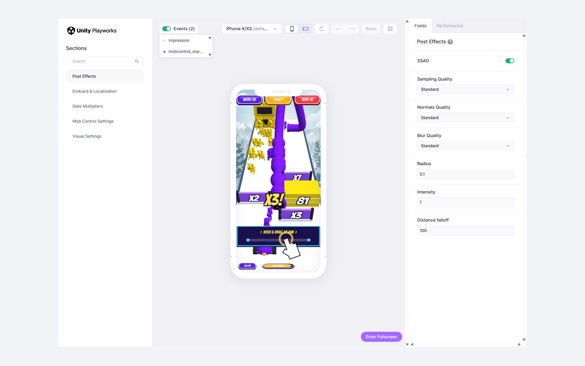
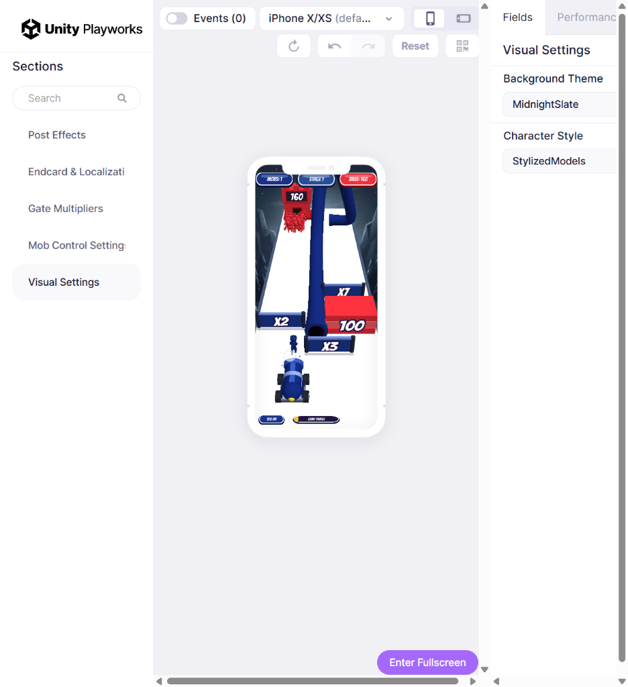
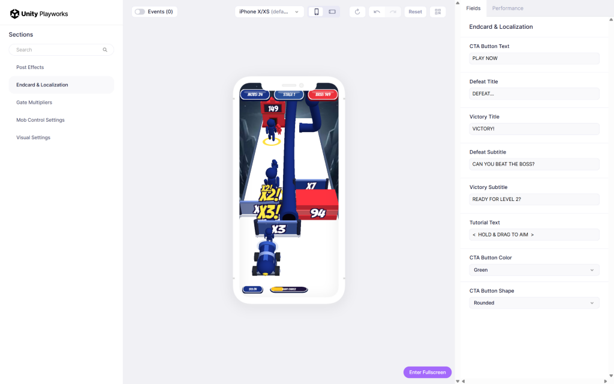
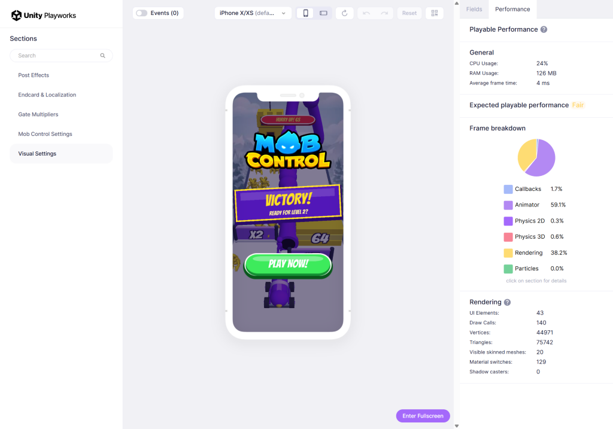
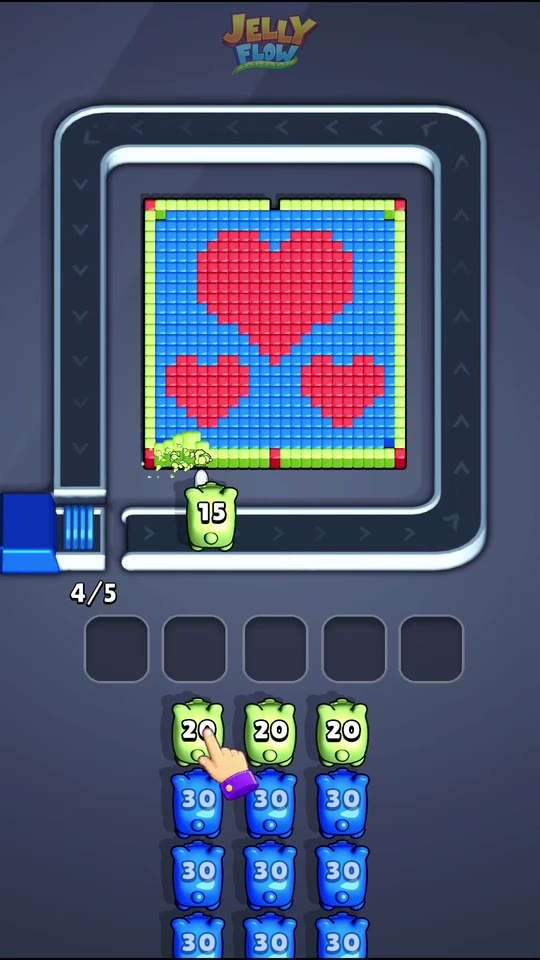
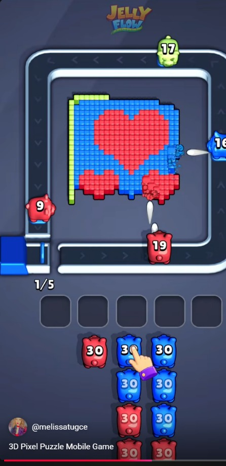
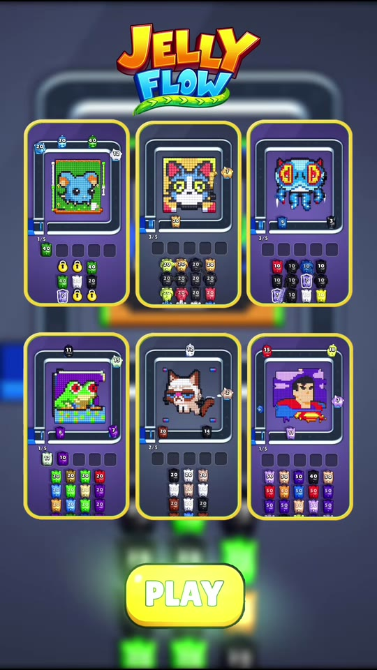

# Playable Ads & Creative Video Portfolio

Playable ads and performance marketing video creatives by **Melisa Tuğçe Haspolat**.  
Interactive 3D HTML5 playable ads are engineered in **Unity 6** and exported with **Unity Playworks (Luna 7.2.0)**; 3D mesh/rig optimization is performed in **Blender 5.0**, and motion design, visual hooks, UI art, and video creatives are crafted in **Adobe After Effects** and **Adobe Illustrator / Photoshop**.

> **Personal Portfolio & All Projects:** [www.melisatugce.com](https://www.melisatugce.com/)

---

## Projects

| Project | Format | Links | Highlights |
|---|---|---|---|
| **Mob Control** | Playable Ad *(Unity Playworks)* | 🎮 [Play Live Demo](https://tugcemelisa.github.io/playable-ads-portfolio/mob-control/)<br>🔗 [This Repo](https://github.com/tugcemelisa/playable-ads-portfolio) | Voodoo-style 3D cannon & mob multiplier playable ad (Playworks Studio + 15 A/B fields on Desktop / Fullscreen on Mobile): 2 full visual themes (`AlpineWinter` & `MidnightSlate`), 2 character styles (522-tri 3D mob + alien vs. classic stickmen), single-mesh arched center tube with gulp waves, sliding `X3`/`X2`/`X7` gates, `GIANT CHARGE` 2.25× Giant Champion, destructible brick block (`100` HP), castle siege (`160` HP), `HURRY UP!` 8s finale, `SFX ON/OFF`, and auto iOS/Android Store CTA. |
| **Number Match** | Game Dev + Creative Video Ad | 🎬 [YouTube Shorts](https://youtube.com/shorts/G4jU1Z6JKeI)<br>🔗 [Game Repo](https://github.com/tugcemelisa/number-match-case-study) | Full Unity 3D colour-by-number pixel art puzzle game (`16×16` rainbow artwork) + 18s 9:16 Creative Video Ad with wrong-move tension hook, 360° radial colour wave reveals, centered `HURRY UP!` countdown alarm, `00:00` explosion transition, and 3D endcard CTA. |
| **Jelly Flow** | Creative Video Ad | 🎬 [YouTube Shorts](https://www.youtube.com/shorts/1l0v7LeWNJU) | 26s 9:16 vertical creative video ad for a 3D pixel-voxel conveyor puzzle game — sunlit 3D CGI plush bunny & bear hook holding 3 red heart balloons matching the 3-heart mosaic board, conveyor color-shooter gameplay (`5/5` track, multi-shooter voxel shatter VFX, 5-slot holding tray tension), and 3D card-flip 6-level showcase endcard with `PLAY` CTA. |
| **Mech Wars** | Creative Video Ads | 🎬 [TikTok (@mechwarsofficial_)](https://www.tiktok.com/@mechwarsofficial_) | 9:16 vertical action shooter UA marketing video creatives (visual hooks, gameplay pacing, motion graphics & endcards) — **all videos on the official TikTok channel were produced by me**. |

---

## Mob Control — Live Playworks Preview & A/B Variant Screenshots

<table>
  <tr>
    <td width="50%" align="center">
      <br/>
      <sub><b>Default Variant (`AlpineWinter` + `StylizedModels`):</b> Active gameplay, sliding `X3`/`X2`/`X7` gates & live `Events` tracker.</sub>
    </td>
    <td width="50%" align="center">
      <br/>
      <sub><b>A/B Variant (`MidnightSlate` + `Visual Settings`):</b> Live theme switch to Deep Navy vs. Crimson Red without rebuilding Unity.</sub>
    </td>
  </tr>
  <tr>
    <td width="50%" align="center">
      <br/>
      <sub><b>A/B Variant (`ClassicStickmen` + `Endcard & Localization`):</b> Giant Champion stickman & live CTA text/color/shape fields.</sub>
    </td>
    <td width="50%" align="center">
      <br/>
      <sub><b>Victory Endcard & Live Performance Profiler:</b> `126 MB RAM`, `4 ms` frame time, `24% CPU`, `140 Draw Calls`, `0` shadow casters.</sub>
    </td>
  </tr>
</table>

---

## Mob Control — Unity Playworks Playground A/B Testing Matrix

Open the [Mob Control Live Playable](https://tugcemelisa.github.io/playable-ads-portfolio/mob-control/) on desktop to test **all 15 `[LunaPlaygroundField]` A/B parameters live** in the Unity Playworks Playground without rebuilding Unity:

| Playground Section | Configurable Parameters | A/B Test Use Case |
|---|---|---|
| **Visual Settings** | `Background Theme` (`AlpineWinter` / `MidnightSlate`)<br>`Character Style` (`StylizedModels` / `ClassicStickmen`) | Day snowy valley (Purple vs. Yellow) ↔ Night slate valley (Deep Navy vs. Crimson Red); 3D animated characters ↔ Classic Mob Control stickmen |
| **Mob Control Settings** | `Cannon Fire Rate`, `Round Duration (s)`, `Yellow Block HP`, `Enemy Base HP`, `Enable Giant Champion`, `Min Lose Time (s)` | Tune pacing for Meta (15s) vs. AppLovin/Unity Ads (24–30s), adjust difficulty & Giant Champion dopamine spikes |
| **Gate Multipliers** | `Front Sliding Gate (X)`, `Left Gate (X)`, `Right Gate (X)` | Test conservative (`X2/X3/X7`) vs. hyper-satisfying crowd multipliers (`X4/X5/X10`) |
| **Endcard & Localization** | `CTA Button Text`, `CTA Button Color` (`Green`/`Blue`/`Yellow`/`Red`/`Purple`), `CTA Button Shape` (`Rounded`/`Sharp`), `Defeat Title`, `Victory Title`, `Defeat Subtitle`, `Victory Subtitle`, `Tutorial Text` | Zero-code localization & CTA color/shape conversion (IPM) experiments |

---

## Mob Control — Live Verified Performance & Engineering

Measured directly inside **Unity Playworks Performance Profiler** (`iPhone X/XS` preview, active combat & endcard):

| Metric | Before Optimization | Final Verified Live | Target (Playworks / MRAID) |
|---|---:|---:|---|
| **RAM Usage** | `881 MB` ⚠️ | **`117 – 124 MB`** | `< 256 MB` ✅ |
| **Average Frame Time** | `12 ms` | **`3 – 6 ms`** *(60+ FPS)* | `< 16.6 ms` ✅ |
| **CPU Usage** | `64%` | **`14% – 36%`** | `< 50%` ✅ |
| **Draw Calls** | `672` | **`117 – 160`** | `< 200` ✅ |
| **Vertices** | `1,260,588` | **`37,511 – 45,792`** | `< 100,000` ✅ |
| **Triangles** | `369,670` | **`61,856 – 75,742`** | `< 100,000` ✅ |
| **Physics 3D CPU** | `23.7%` | **`0.6% – 0.8%`** | `< 5%` ✅ |
| **Shadow Casters** | `0` | **`0`** | `0` ✅ |
| **Exported Asset Bundle** | `~4.8 MB` | **`1.23 MB`** | `≤ 2–5 MB` ✅ |

### Key Technical Optimizations
- **6-Pool Zero-GC Object Pooling:** Friendly mobs, enemy aliens, smoke puffs, shockwave rings, sparks/debris, and World-Space floating `Canvas` pop-ups are recycled via `Stack<T>` pools — eliminating WebGL heap growth (`881 MB → 124 MB`).
- **Blender 5.0 FBX Pipeline:** Stripped 28+ unused animation clips (retaining only `CharacterArmature|Run`), removed heavy hair/accessory submeshes, collapsed `PurpleMob.fbx` from 11 materials to **1 single material / 522 tris** (`4,155 KB → 330 KB`), and preserved `YellowMob.fbx` alien eyes (`Eye_Black` / `Eye_White`) while cutting polygons by 55%.
- **Single-Mesh Procedural Tube (`88 → 1 Draw Call`):** Replaced 88 separate cylinder/sphere tube segments with a single C# swept `UnityEngine.Mesh` (`BuildSmoothTubeMesh`) paired with 10 pooled bulge beads for smooth entrance-to-exit gulp waves.
- **Playworks 7.2.0 WebGL Compatibility:** Per-`Color32` cached shared materials (`Prims._matCache`), non-sliced procedural `AdRes.Pill` UI sprites, 4-way World-Space `UI.Text` comic strokes (Bangers font), and mobile-safe CTA redirect (`window.open` + `top.location` fallback with auto iOS App Store / Android Google Play routing).

---

## Jelly Flow — Creative Video Breakdown & Keyframe Previews

A **26-second 9:16 vertical UA creative** ([Watch on YouTube Shorts](https://www.youtube.com/shorts/1l0v7LeWNJU)) structured around a 3-beat conversion funnel:
- **0:00 – 0:03 | 3D CGI Visual Motif Hook:** Stylized 3D plush red bunny & green bear holding three glossy red heart balloons along a sunlit cloud path — establishing the exact 3-heart visual motif before cutting straight into the 3-heart pixel-voxel board.
- **0:03 – 0:20 | Conveyor Color-Shooter Gameplay & Holding-Tray Tension:** Animated gloved tap hand launches numbered jelly shooters (`20`, `30` ammo) onto a `5/5` loop conveyor; simultaneous multi-angle paint streams shatter matching voxel pixels while unmatched shooters drop into the 5 holding slots to create resource-management tension.
- **0:21 – 0:26 | 3D Card-Flip Multi-Level Endcard:** Swoosh-trailed 3D card flip reveals 6 live animated mini-level preview cards (mouse, calico cat, alien, frog, grumpy cat, superhero) under the **JELLY FLOW** logo and pulsing yellow **PLAY** CTA.

<p align="center">
  
  
  
  
</p>

---

## Tech Stack

- **Unity 6 (`6000.0.51f1`) & Unity Playworks (Luna `7.2.0`)** — Interactive 3D playable ad architecture, Playground A/B fields & HTML5 export
- **Blender `5.0`** — Low-poly mesh decimation, material slot merging & animation clip stripping
- **Adobe After Effects & Adobe Illustrator / Photoshop** — 9:16 vertical creative video hooks, vector UI badges, raster art, voiceover & 3D endcards
- **Shared `AdKit`** — Procedural pill UI, World-Space labels, drag tutorial hand, baked WAV SFX & Playworks lifecycle/CTA bridge

---

## Open and Export in Unity

Use Unity **6000.0.51f1** with **Unity Playworks Plugin 7.2.0**:
1. From the top menu bar, open **`Playable Ads → Open Scene → Mob Control`**.
2. To build and sync directly to `Builds/Playables/` and `docs/<slug>/`, click **`Playable Ads → Export Playworks → Mob Control`** (or open **Tools → Unity Playworks Plugin** → **Build Develop**).

```text
Assets/
├── AdKit/         Shared Playable Ad UI, Pills, World-Space Labels, Object Pooling Helpers, SFX & Export Menu
├── MobControl/    Mob Control 3D Playable Ad (Optimized FBX Models, Alpine/Midnight Backdrops, Logo & Scripts)
└── Scenes/        MobControl.unity
```
